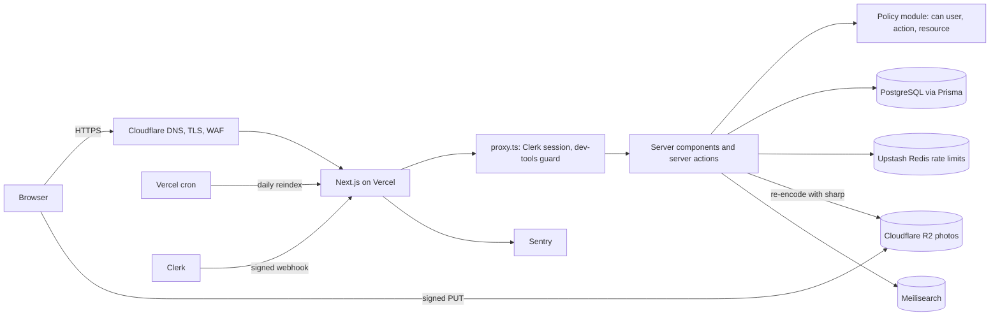

# Soko marketplace

A two-sided marketplace where sellers in Nairobi list items and buyers find, buy and review them. It is mobile first and built for slow connections. Payment is held until the buyer confirms delivery, and buyers can pay with M-Pesa or a card. "Soko" is a placeholder brand name.

The work is split into six phases (see `docs/decisions.md` for the plan and the choices made along the way). **Phase 1 (Foundation)** is in place: database schema, sign-in with roles, the permission policy, the security baseline, the design system and the base layout.

## Tech stack

| Layer       | Choice                                                                                        |
| ----------- | --------------------------------------------------------------------------------------------- |
| App         | Next.js 16 (App Router, Cache Components / Partial Prerendering), React 19, TypeScript strict |
| UI          | Tailwind CSS 4, Radix primitives in shadcn-style components, lucide icons                     |
| Data        | PostgreSQL, Prisma 7 (`@prisma/adapter-pg`)                                                   |
| Auth        | Clerk (email, phone OTP, Google). A local dev sign-in is used for development and tests       |
| Rate limits | Upstash Redis, with an in-memory fallback locally                                             |
| Photos      | Cloudflare R2 (signed direct uploads, re-encoded to WebP with sharp); local disk in dev/CI    |
| Search      | Meilisearch (typo-tolerant, faceted), with a Postgres `pg_trgm` fallback                      |
| Monitoring  | Sentry                                                                                        |
| Tests       | Vitest (unit), Playwright + axe (end to end, at phone and desktop sizes)                      |

Coming in later phases: Paystack and M-Pesa Daraja payments, a background worker, Resend, Africa's Talking and PostHog.

## Getting started

Requirements: Node 22, pnpm 10 and PostgreSQL 16.

```bash
pnpm install                 # also generates the Prisma client
cp .env.example .env         # the defaults work with a local Postgres
createdb market              # or point DATABASE_URL at any empty database
pnpm db:migrate              # apply migrations
pnpm db:seed                 # Nairobi demo data
pnpm dev                     # http://localhost:3000
```

With `AUTH_PROVIDER=dev`, go to **/dev/sign-in** to sign in as a seeded user or create a new account. Then go to **/dev/roles** to switch your own seller, moderator and admin roles. Both pages are dev-only and return 404 on a deployed site.

Seeded accounts:

| User                                                                     | Roles                         |
| ------------------------------------------------------------------------ | ----------------------------- |
| Achieng Admin                                                            | buyer, admin                  |
| Kamau Moderator                                                          | buyer, moderator              |
| Njeri Buyer, Otieno Buyer                                                | buyer                         |
| Wanjiku Mwangi, Baraka Ochieng, Amina Hassan, Kiprop Kirui, Zawadi Mutua | buyer, seller (one shop each) |
| Suspended User                                                           | suspended seller              |

The design system gallery is at **/dev/components**.

## Scripts

| Command                                              | What it does                                                                          |
| ---------------------------------------------------- | ------------------------------------------------------------------------------------- |
| `pnpm dev`                                           | Start the dev server                                                                  |
| `pnpm build` / `pnpm start`                          | Production build and server                                                           |
| `pnpm lint` / `pnpm typecheck` / `pnpm format:check` | Static checks (CI runs all three)                                                     |
| `pnpm test`                                          | Unit tests                                                                            |
| `pnpm test:e2e`                                      | End-to-end tests. Build first with `AUTH_PROVIDER=dev ALLOW_DEV_AUTH=true pnpm build` |
| `pnpm db:migrate`                                    | Create and apply a migration after changing `prisma/schema.prisma`                    |
| `pnpm db:deploy`                                     | Apply migrations (CI and deploys)                                                     |
| `pnpm db:seed` / `pnpm db:reset`                     | Reseed demo data / drop, migrate and reseed                                           |
| `pnpm search:reindex`                                | Rebuild the Meilisearch index from Postgres (needs `MEILISEARCH_*`)                   |
| `pnpm perf:budget`                                   | Check each key page's JavaScript against its size budget (after `pnpm build`)         |
| `pnpm load-test`                                     | Load test key pages: `pnpm load-test https://staging...` (never production)           |
| `scripts/restore-drill.sh`                           | Back up, restore into a scratch database and compare row counts (see backup guide)    |

## Environment variables

All of them are documented in [`.env.example`](.env.example) and validated at startup by `src/lib/env.ts`. A missing or invalid value stops the app with a clear message. The important rule is that a deployed site must use `AUTH_PROVIDER=clerk`. The app refuses to start with dev sign-in on Vercel, and in any production build unless `ALLOW_DEV_AUTH=true` is set (only the e2e tests do that).

Accounts you'll need before deploying: Clerk, a managed Postgres (Neon or Supabase), Upstash Redis, Sentry, Vercel, Cloudflare R2 (photos) and Meilisearch Cloud (search). Without R2, photo uploads are switched off on a deployed site; without Meilisearch, search falls back to Postgres. Phase 3 adds Paystack (payments and payouts) and Resend (email); Phase 4 adds a private R2 bucket, an encryption key and Africa's Talking (SMS).

Phase 2 setup on Vercel: add `R2_ACCOUNT_ID`, `R2_ACCESS_KEY_ID`, `R2_SECRET_ACCESS_KEY`, `R2_BUCKET`, `NEXT_PUBLIC_IMAGE_ORIGIN`, `MEILISEARCH_HOST`, `MEILISEARCH_ADMIN_KEY` and `CRON_SECRET`, redeploy, then run `pnpm search:reindex` once against production (or wait for the nightly cron).

Phase 4 setup: create a second R2 bucket with public access OFF and set `R2_PRIVATE_BUCKET`, set `ENCRYPTION_KEY` (`openssl rand -base64 32`, keep a copy somewhere safe), and add `AT_USERNAME`/`AT_API_KEY` for SMS. Give at least one person the moderator role; the queues are at `/admin/moderation`.

Phase 5 setup: in Clerk, turn on multi-factor (authenticator app and SMS) under User and authentication, Multi-factor. Every moderator and admin must turn on two-step verification at Account, Security before the admin area opens for them. Optionally add `NEXT_PUBLIC_POSTHOG_KEY` (a PostHog EU project) for funnel analytics, and create the Sentry alert rules in `docs/monitoring.md`. The admin area is at `/admin`.

Phase 3 setup: add `PAYSTACK_SECRET_KEY`, `RESEND_API_KEY` and `EMAIL_FROM`, then in Paystack set the webhook URL to `https://<domain>/api/webhooks/paystack`, enable M-Pesa and transfers, and turn off OTP for API transfers. Locally, checkout uses a mock gateway: after placing an order, follow the "sandbox" link on the order page to approve or fail the payment, and read sent emails at `/dev/outbox`.

Phase 6 setup: follow the launch checklist in [`docs/launch.md`](docs/launch.md). In short: turn on Bot protection in Clerk, optionally add `TURNSTILE_SECRET_KEY` and `NEXT_PUBLIC_TURNSTILE_SITE_KEY` (a Cloudflare Turnstile widget) for first messages, point an uptime check at `/api/health`, have a lawyer review the legal drafts, and run the backup drill in [`docs/backup-restore.md`](docs/backup-restore.md).

## Architecture



```
prisma/                schema, migrations, seed
src/app/               routes: (public), (auth), (account), (seller), (admin), dev/, api/webhooks
src/components/ui/     design-system components
src/components/        feature components (header, listing card, …)
src/server/auth/       identity (Clerk or dev), current user, Clerk sync
src/server/policy/     can() and its tests — every permission decision lives here
src/server/queries/    cached public reads (active listings only)
src/server/search/     Meilisearch + Postgres fallback, index sync
src/server/storage/    R2 and local-disk photo storage
src/server/images/     photo checks and re-encoding
src/server/payments/   Paystack and mock gateways, webhook handling
src/server/orders/     order state changes, refunds, payouts, scheduled maintenance
src/server/email/      email templates and the outbox
src/server/notifications/, sms/  in-app, email and SMS notifications
src/server/private-files/        ID documents and dispute photos (private bucket)
src/server/actions/    server actions
src/lib/               env validation, money (integer KES), security headers, utils
tests/e2e/             Playwright tests
docs/                  decisions, security checklist, monitoring and alert rules
```

### How permissions work

The auth provider only tells us who someone is. What they may do comes from our own database, through `src/server/policy/can.ts`. Every page, server action and route handler loads the resource and then calls `can()` or `assertCan()` with it. The proxy never makes access decisions, so a missed route matcher can't open a hole. Suspended users are denied everything.

### Money

All amounts are integers in minor units (KES cents). Use the helpers in `src/lib/money.ts` and never use floats.
